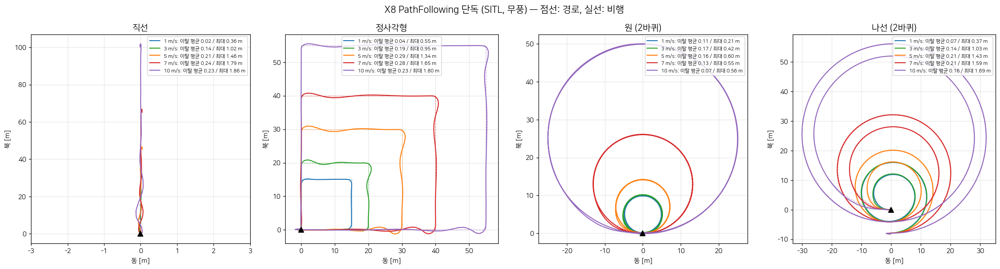

# 2026-10-17 X8 실기체 비행시험 절차

시험은 두 가지입니다.
1. **PF 단독 경로 비행:** 원, 정사각형, 나선, 직선을 1·3·5·7·10 m/s로 비행합니다. 직선은 1·3·5·7 m/s에서 송풍기 5 m/s를 맞습니다.
2. **회피 비행:** 3 m/s 조기 회피판(`x8_3n`)부터 시작합니다. 그다음 같은 코스에서 흔들림이 가장 적은 알고리즘(인하대 X8 5 m/s 판 + 재가속 제한, `x8_5s`)으로 비행합니다. 예비안은 전북대 T1000 + PF입니다.

온보드 컴퓨터는 `keeyongchoi-jetson-orinnano-002`입니다.

## 0. 온보드 컴퓨터 (orin-nano-02)

| 항목 | 값 |
|---|---|
| 접속 | `ssh jetson@100.64.0.18` (Tailscale, 와이파이 경유) / `jetson@192.168.219.229` (연구실 LAN `eno1`) |
| 이미지 | `a4vai-base:humble` → `a4vai-pils:humble` → `a4vai-onboard:humble` (2026-10-16 밤 빌드) |
| 작업공간 | `~/Documents/A4VAI-SITL/ROS2` (ros2_ws, livox_ws, cosys-airsim), 스크립트 `~/PX4-SITL-Runner` |
| 빌드 검증 | PILS_BUILD_OK (21분), livox_ros_driver2 빌드 완료, PILS 비행 (§4) |

다시 만들 때(새 젯슨):
```
scripts/dev/jetson_base_setup.sh jetson@HOST                          # 기본 이미지 (JetPack r36.4 + ROS2 + Agent 2.4.3 ...)
PILS_BASE_IMAGE=a4vai-base:humble scripts/dev/pils_jetson_setup.sh jetson@HOST
scripts/dev/onboard_livox_setup.sh jetson@HOST
```
코드만 고쳤을 때(파이썬, 스크립트)는 `PILS_SKIP_BUILD=1 scripts/dev/pils_jetson_setup.sh jetson@HOST`로 동기화만 하면 됩니다.

### 현장 연결 (사용자 작업, sudo 필요)
- **현장 인터넷 (꼭 출발 전에 시험):** 현장에는 연구실 와이파이가 없습니다. 젯슨 2를 휴대폰 USB 테더링이나 노트북 핫스팟에 붙여서 Tailscale이 살아 있어야 PC나 노트북에서 접속할 수 있습니다. 어제 1번 젯슨도 USB 5G 테더링(`usb2`)으로 붙었습니다.
  - 확인 방법: 테더링을 연결한 뒤 PC에서 `tailscale status | grep 100.64.0.18`을 보고 `ssh orin-nano-02 hostname`이 되는지 봅니다.
- **Mid-360 직결 (회피 비행만):** `eno1`을 라이다용 고정 IP로 바꿉니다. 연구실 LAN은 끊기고, 접속은 테더링 + Tailscale로 합니다.
  ```
  sudo nmcli connection add type ethernet ifname eno1 con-name livox-mid360 ipv4.method manual ipv4.addresses 192.168.1.50/24
  sudo nmcli connection up livox-mid360        # 되돌리기: sudo nmcli connection up "<원래 유선 프로필>"
  ```
- **Pixhawk:** TELEM2 → USB-시리얼 → 젯슨입니다. PX4 파라미터는 `UXRCE_DDS_CFG` = TELEM2(102), `SER_TEL2_BAUD` 921600, `UXRCE_DDS_DOM_ID` 0입니다. 장치 이름은 `ls /dev/ttyUSB* /dev/ttyACM*`로 확인합니다.
- **에이전트 (한 번 띄우고 계속 둠):** `scripts/dev/onboard_real.sh agent start /dev/ttyUSB0 921600`
  - Pixhawk는 젯슨 2에서 `/dev/ttyUSB0`(CP2102)로 보입니다(10-17 확인).
  - 에이전트는 Fast DDS를 UDP 전용으로 씁니다(`fastdds_udp_only.xml`). 공유메모리로는 앱에 `/fmu` 토픽이 안 보였습니다.
- **X8 Mid-360 주소는 192.168.1.182**입니다. X500은 .100입니다. x8 프로필에 `LIVOX_LIDAR_IP`로 들어 있고, `calib`/`shadow`에서는 `LIVOX_LIDAR_IP=192.168.1.182`를 붙이세요.
- **연구실 와이파이:** 같은 와이파이에 붙은 PC 시뮬레이션의 도메인 0 토픽이 젯슨에 섞여 보였습니다. 현장에서는 젯슨 와이파이를 끄고 테더링만 쓰세요.
  - **함정:** 에이전트를 재시작했거나 USB를 다시 꽂았다면, 에이전트를 먼저 띄운 뒤 **Pixhawk를 재부팅**해야 합니다. PX4 1.16은 새 에이전트에 다시 붙지 않습니다.

## 1. 아침 보정 (실측)

| 무엇 | 명령 (젯슨, `~/PX4-SITL-Runner`) | 넣을 곳 |
|---|---|---|
| 라이다 장착 (회피만) | `onboard_real.sh calib cal1` → `onboard_real.sh tool lidar_mount_calib.py shake / rest / target` → `onboard_real.sh stop cal1` | `NOCLIMB_LIDAR_YAW_DEG / ROLL / PITCH / Z / LATENCY` |
| 자기 반사 반경 (회피만) | `onboard_real.sh tool livox_bench_check.py 10` | `NOCLIMB_SELF_RADIUS` (X8 기본 0.9) |
| 지면 높이 (회피만) | `lidar_mount_calib.py rest --yaw Y --centre-height H` (H = 지면에서 X8 중심까지 실측 높이) | `NOCLIMB_GROUND_Z=-H NOCLIMB_AGL_OFFSET=H` (기본은 SITL 모델값 0.44; X500은 실측 0.30이었음) |
| 호버 추력 | 첫 PF 비행(직선 1 m/s)을 `stop`한 뒤, PC에서 `scp jetson@100.64.0.18:Documents/A4VAI-SITL/ROS2/test_runs/NAME/pf_log.csv .` → `python3 scripts/dev/hover_thrust.py pf_log.csv --assumed 0.444` | `NOCLIMB_HOVER_THRUST` (0이면 octo.yaml 0.444) |

- **X8 실측 (10-17 아침, 사용자):** Pixhawk(기체 중심) 0.55 m, Mid-360 0.60 m(지면 기준) → `NOCLIMB_LIDAR_Z=0.05 NOCLIMB_GROUND_Z=-0.55 NOCLIMB_AGL_OFFSET=0.55`, 라이다 주소 `LIVOX_LIDAR_IP=192.168.1.182`. 시뮬레이션(라이다 0.30 m, 중심 0.44 m)과 달라서 프로필에는 넣지 않고 명령 앞에 붙입니다.
- 측정값은 명령 앞에 환경변수로 붙이면 프로필보다 우선합니다. 예: `NOCLIMB_HOVER_THRUST=0.47 NOCLIMB_LIDAR_YAW_DEG=178 ...`
- `onboard_real.sh tool`은 실행 중인 컨테이너 안에서 돕니다. `stop` 뒤에는 컨테이너가 없으므로 PC에서 돌리세요.
- 지면 높이가 틀리면, 2 m 높이 비행에서 바닥 반사가 정책 입력 영상에 장애물로 들어갑니다.
- 호버 추력이 10 % 틀리면 PF 외란 관측기(상한 4 m/s²) 중 약 1 m/s²를 그 오차가 차지합니다. 젯슨과 라이다를 실어 무게가 늘었으면 꼭 측정하세요.

## 2. PF 단독 경로 비행 (라이다 불필요)

```
scripts/dev/pf_field.sh table                                # 크기·공간
scripts/dev/pf_field.sh SHAPE SPEED HEADING [NAME]           # 예: pf_field.sh circle 5 300 c5
scripts/dev/onboard_real.sh state                            # READY 확인
scripts/dev/onboard_real.sh go                               # 이륙 → 경로 → 끝점(직선) / 출발점(나머지) 착륙
scripts/dev/onboard_real.sh stop NAME                        # 로그 수거
```
- **HEADING:** 직선 방향, 정사각형 첫 변, 원·나선 중심이 있는 쪽의 방위각(°, 북 0)입니다. 빈 쪽으로 돌려서 씁니다. 원과 정사각형은 기본 오른쪽(시계 방향)으로 돌고, `PF_FIELD_TURN=left`로 바꿀 수 있습니다.
- **이륙점:** 모양은 이륙점에서 시작합니다. 고도 5 m(`MISSION_ALT`)이고, 프로필은 `x8_5s`(호버 추력·기울기 30°)입니다.
- **안전 장치:** 조종기를 Position으로 바꾸면 그 순간 양보합니다. 속도가 비행 속도 + 2.5 m/s를 넘거나, 미션 범위 + 20 m 펜스를 벗어나면 그 자리에 착륙합니다.

| 속도 | 직선 길이 | 정사각형 변 | 원 반지름 (지름) | 나선 반지름 (안→밖) | 필요한 공간 (최대 반경) |
|---|---|---|---|---|---|
| 1 | 15 m | 15 m | 5 m (10) | 5 → 13 m | 21 m |
| 3 | 30 m | 20 m | 5 m (10) | 5 → 13 m | 30 m |
| 5 | 45 m | 30 m | 7 m (14) | 7 → 15 m | 45 m |
| 7 | 65 m | 40 m | 13 m (26) | 13 → 21 m | 65 m |
| 10 | 100 m | 55 m | 25 m (50) | 25 → 33 m | 100 m |

- **직선 끝:** 착륙 전환 때 1.0–1.9 m 앞으로 지나칩니다. 끝점 너머로 5 m 이상 비워 두세요.
- **공간이 모자랄 때:** 더 작게 하려면 `PF_FIELD_SIZE`를 씁니다. 다만 7·10 m/s 원을 작게 하면 기울기가 커집니다(v²/R ≤ 4 m/s² 기준으로 정한 크기).
- **송풍기 직선:** 송풍기 바람이 직선을 가로지르거나 맞서게 HEADING을 정합니다. 1·3·5·7 m/s를 각각 `pf_field.sh line V HEADING`으로 비행합니다.
- **직선 끝 착륙:** 직선은 끝점(10 m/s면 100 m 밖)에 착륙합니다. 다음 비행은 그 자리가 이륙점이 되니, 기체를 옮기거나 HEADING을 반대로 해서 돌아오세요.
- **실기체 첫 사용:** `mission.sh`(wp_local)는 SITL과 PILS에서만 비행했습니다. 어제 실기체 비행은 `fly`였습니다. 다만 이륙·OFFBOARD·착륙을 맡는 flight_driver는 같은 코드입니다. 첫 비행은 1 m/s 직선으로 하세요.
- **연구실에서 미리 해 볼 때:** 연구실 망에는 도메인 0을 쓰는 다른 ROS2 기기가 있을 수 있습니다. 미리보기 실행 중 Pixhawk 없이도 `/fmu` 토픽이 한 번 보였습니다. 현장(테더링만 연결)에서는 해당 없습니다.

### SITL 결과 (X8 Gazebo, flight_driver + PF, 같은 경로 생성기, 2026-10-16 밤): 32회 + 기울기 30° 재검증 10회, 모두 끝까지 비행하고 착륙



| 모양 | 1 | 3 | 5 | 7 | 10 m/s |
|---|---|---|---|---|---|
| 직선: 좌우 오차 최대 / 끝 지나침 | 0.03 / 0.4 | 0.03 / 1.0 | 0.06 / 1.5 | 0.07 / 1.8 | 0.12 / 1.9 m |
| 정사각형: 이탈 평균 / 최대 (모서리) | 0.04 / 0.55 | 0.19 / 0.96 | 0.29 / 1.34 | 0.28 / 1.65 | 0.23 / 1.80 m |
| 원 2바퀴: 이탈 평균 / 최대 | 0.11 / 0.21 | 0.17 / 0.42 | 0.16 / 0.60 | 0.13 / 0.55 | 0.07 / 0.56 m |
| 나선 2바퀴: 이탈 평균 / 최대 | 0.07 / 0.37 | 0.14 / 1.03 | 0.16 / 1.43 | 0.21 / 1.59 | 0.16 / 1.69 m |

- 위 표는 PF 기본 기울기 한계 35°로 비행한 결과입니다. **현장 설정 30°(x8_5s)로 7·10 m/s 네 모양과 바람 7 m/s 직선을 다시 비행했고, 10회 모두 끝까지 비행했습니다.**
  - 차이: 직선 끝 지나침 1.9 / 2.2 m(7 / 10 m/s), 정사각형 최대 1.9 / 2.2 m, 원 최대 0.55 / 0.61 m, 나선 최대 1.8 / 2.0 m. 맞바람·옆바람 7 m/s도 성공했습니다.
  - 7·10 m/s에서는 비행 시간의 8–19 %가 30° 한계에 닿습니다(모서리, 가감속). 실기체는 동체 항력이 있어 더 자주 닿을 수 있으니 10 m/s는 원 → 직선 순으로 해 보세요.
- 속도는 모든 비행에서 목표대로 나왔습니다(직선·원 중간 구간 ±0.1 m/s).
- 정사각형은 모서리에서 감속합니다. 90° 모서리를 약 4.5 m/s로 돌기 때문에 7·10 m/s 정사각형은 변 중간에서만 목표 속도가 납니다.

**바람 5 m/s, 직선** (Gazebo 바람 = 로터 항력만, 동체 항력 없음 → 실제보다 약할 수 있음)

| 바람 | 1 | 3 | 5 | 7 m/s: 좌우 오차 최대 |
|---|---|---|---|---|
| 없음 | 0.03 | 0.03 | 0.06 | 0.07 m |
| 맞바람 5 | 0.04 | 0.04 | 0.04 | 0.05 m (고도 오차 최대 0.5 m @3–5 m/s) |
| 옆바람 5 | 0.04 | 0.12 | 0.17 | 0.23 m |

- PF 외란 관측기가 바람을 바로 추정했습니다. 7 m/s 맞바람에서 1.27 m/s², 옆바람에서 0.57 m/s²였습니다.
- 송풍기는 국소적이라 들어갈 때와 나올 때 순간 변화가 있습니다. 시뮬레이션의 균일한 바람보다 급하게 바뀝니다. 1 → 3 → 5 → 7 순서로 올리세요.

## 3. 회피 비행 (인하대 X8 5 m/s 판 + 재가속 1.5 m/s², `x8_5s`)

선정 근거: 같은 C-Track 코스, X8 SILS, 2026-10-16

| 후보 | 비행 | 롤 / 피치 흔들림 (°/s) | 합 | 최악 1초 | 접촉 |
|---|---|---|---|---|---|
| **인하대 5 m/s 판 + 재가속 1.5 (x8_5s)** | 5 | 3.5 / **5.3** | **6.4** | 25 | **0** (최소 +0.52 m) |
| 전북대 T1000 + PF | 5 | **2.7** / 5.8 | 6.5 | 25 | 1 (C1 −0.06 m) |
| 전북대 T1000 → PX4 직결 | 4 | 1.8 / 6.8 | 7.0 | 35 | 1 (C3 −0.02 m) |
| 인하대 3 / 4 m/s 판 + 재가속 1.5 | 각 2 | 3.0–3.4 / 5.4–6.5 | 6.1–7.2 | 28–34 | 0 |
| 인하대 제한 없음 (3/4/5 m/s) | 각 1–2 | 6.1–10.2 / 4.6–9.2 | 7.6–13.7 | 20–34 | 0 |

흔들림 합은 인하대 5 m/s 판 + 제한과 T1000+PF가 같은 수준입니다. 그래서 접촉이 없는 인하대 쪽으로 정했습니다. 평균 속도도 인하대가 3.5 m/s로 T1000의 3.2 m/s보다 빠릅니다.

**순서 (5 m/s로 바로 가지 않음):** 그림자 시험 → **3 m/s `x8_3n`** → 문제없으면 5 m/s `x8_5s`

- X8 회피 비행은 실기체에서 처음입니다. 실제 기체가 명령을 얼마나 늦게 따라가는지 모릅니다.
- 어제 X500은 5 m/s에서 넓은 벽 앞에서 늦게 제동했습니다.
- `x8_5s`도 열린 구간에서는 5 m/s까지 냅니다.

```
# 1단계: 3 m/s, 조기 회피판 (x8_smooth_early_onnx/v3)
NOCLIMB_GOAL_GPS=LAT,LON NOCLIMB_ALT=2 [측정값들] scripts/dev/onboard_real.sh fly x8_3n NAME
# 2단계: 5 m/s, 흔들림 최소 (soft + 재가속 1.5)
NOCLIMB_GOAL_GPS=LAT,LON NOCLIMB_ALT=2 [측정값들] scripts/dev/onboard_real.sh fly x8_5s NAME
scripts/dev/onboard_real.sh state → go → (도착 후 착륙) → stop NAME
```

| 프로필 | 정책 | SILS (C-Track, X8) | 젯슨 2 PILS |
|---|---|---|---|
| `x8_3n` | `x8_smooth_early_onnx/v3` | 3회: 여유 +1.49–1.87 m, 회피 시작 10.8 m, 롤 4.5 / 피치 7.8 °/s | +1.56 m (C2), 평균 2.90 m/s |
| `x8_5s` | `x8_30m_soft_onnx` + 재가속 1.5 | 6회: 여유 +0.52–1.19 m, 롤 3.5 / 피치 5.3 °/s | +0.70 m (C1) |

- `x8_3n`은 장애물을 훨씬 일찍·넓게 피합니다. 대신 기둥 사이에서 속도를 출렁여 피치 흔들림이 큽니다.
- 지금 3 m/s 판(`x8_3`)은 여유 +0.58–0.72 m로 더 붙어서 지나갑니다.
- 먼저 그림자 시험(프로펠러 없이 들고 걷기)으로 정책 출력을 확인합니다. `SHADOW_AIRFRAME=x8 NOCLIMB_POLICY_DIR=x8_30m_soft_onnx NOCLIMB_POLICY=ca_x8_30m_soft [측정값들] onboard_real.sh shadow NAME`. Foxglove에서 `ws://<젯슨>:8765`로 봅니다.
- 고도: 어제 X500은 2 m였습니다. X8은 프롭 끝 반경이 0.77 m라 장애물 옆 여유가 더 필요합니다.

예비안 (T1000 + PF, 3 m/s 고정):
```
NOCLIMB_GOAL_GPS=LAT,LON NOCLIMB_ALT=2 [측정값들] scripts/dev/onboard_real.sh fly-t1000 x8_5s NAME
```
프로필에서는 기체, 라이다 장착값, PF 설정만 씁니다. T1000은 미리보기 모드로 돌아서 PX4에 직접 명령하지 않고, flight_driver와 PF가 비행합니다.

## 4. 전날 검증 (2026-10-16 밤)
- `x8_5s` SILS (`gate_sils_x8_5s_a`) — §3 표의 5회와 같은 설정
- T1000 + PF, 라이다를 어댑터 `/cloud`로 받는 실기체 경로 (`T1000_CLOUD_WORLD=1`, `ctrack_t1000_pf_cw_a`)
- 젯슨 2 PILS (`gate_pils02_x8_5s_a`, 연구실 LAN)

| 비행 | 결과 | 최소 여유 | 평균 / 최대 속도 | 롤 / 피치 흔들림 |
|---|---|---|---|---|
| `x8_5s` SILS | 착륙, 목표 0.60 m | +0.81 m (C3) | 3.42 / 4.95 m/s | 3.5 / 5.6 °/s |
| T1000+PF, `/cloud` 경로 | 착륙, 목표 0.47 m | +4.25 m (크게 우회) | 3.24 / 3.47 m/s | 3.7 / 3.8 °/s |
| **젯슨 2 PILS `x8_5s`** | 착륙, 목표 0.57 m | +0.70 m (C1) | 3.26 / 5.00 m/s | 3.0 / 7.4 °/s |

- 젯슨 2 부하: 노드 한 스텝 중앙값 14.6 ms, p95 24.1 ms. 20 Hz 간격 p95는 54 ms이고, MPPI 풀이는 7.5 / 17.8 ms입니다(1번 젯슨과 같은 수준).
- MPPI GPU 커널(pycuda)은 젯슨 2에서 정상으로 돌았습니다. PF 단독 미션도 같은 노드를 씁니다.
